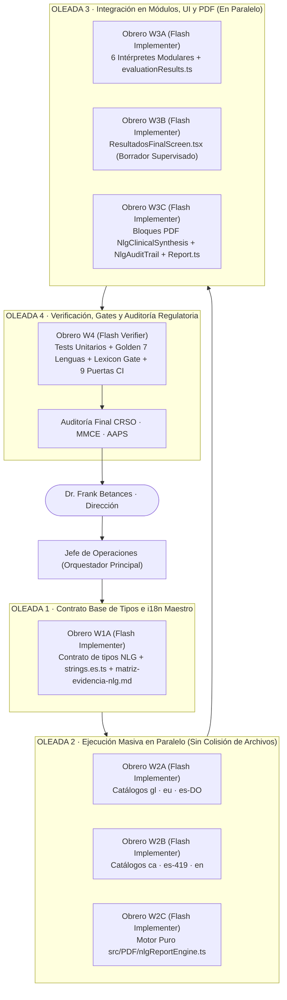

# Plan de Organización del Enjambre de Agentes: Ejecución del Motor NLG Determinista (VIA+)

> **Estado:** Plan de orquestación y contratos de ejecución para enjambre multi-agente.
> **Rama activa:** `NLG`
> **Documento técnico asociado:** [`docs/PLAN_NLG_ENGINE.md`](./PLAN_NLG_ENGINE.md)
> **Gobernanza:** `jefe-operaciones` · `CLAUDE.md` · MDR 2017/745 Clase IIa · IEC 62304 Clase B · ISO 14971:2019.

---

## 1. Goal Description y Principios de Orquestación

Organizar, coordinar y gobernar un **enjambre de agentes autónomos especializados** bajo la dirección del **Jefe de Operaciones** (agente orquestador en el contexto principal) para ejecutar de principio a fin el plan [`docs/PLAN_NLG_ENGINE.md`](./PLAN_NLG_ENGINE.md) sobre la rama `NLG` del repositorio `via`.

### 1.1 Principios Inviolables de Operación

1. **Separación estricta Dirección / Ejecución (`jefe-operaciones`):** El contexto principal actúa exclusivamente como **Jefe de Operaciones**: define contratos de interfaz tipados, lanza oleadas de subagentes rápidos (`Model: "flash"`), audita los `git diff` y verifica las puertas de salida. No se escribe código mecánico masivo en el contexto principal.
2. **Aislamiento de ficheros por contrato (Cero Colisiones):** Ningún fichero del repositorio puede ser editado simultáneamente por dos subagentes en la misma oleada. La matriz de propiedad de archivos (§4) es de cumplimiento obligatorio.
3. **Eficiencia estricta de recursos (Regla R00 y Subregla Diamante):** Se prohíben bucles recursivos de subagentes o exploraciones abiertas sin límite. Cada subagente recibe las rutas exactas, las firmas TypeScript cerradas y los criterios binarios de aceptación.
4. **Honestidad empírica (Regla 0 de `CLAUDE.md`):** Ningún obrero puede declarar su contrato como completado sin adjuntar el comando exacto ejecutado y su código de salida (`0`).

---

## 2. User Review Required

> [!IMPORTANT]
> **1. Comité de Veto Regulatorio y Técnico (CRSO · MMCE · AAPS)**
> Antes de dar por superada cada oleada, el Jefe de Operaciones contrasta el entregable contra las restricciones incondicionales de los tres roles de gobernanza de Earlify Health:
> - **CRSO (Clinical Regulatory & Safety Officer):** Veto inmediato si aparece lenguaje diagnóstico/nosológico («patológico», «normal», «sano», «descarta»), si un dato `null` cae en la rama favorable, o si falta la referencia a la matriz de evidencia en algún `ruleId`.
> - **MMCE (Multiplatform Mobile Core Engineer):** Veto inmediato si aparece un solo literal de interfaz fuera de `src/I18n/`, si `npx tsc --noEmit` arroja cualquier error entre las 7 variedades, o si `npx eslint` presenta errores o avisos (`warnings > 0`).
> - **AAPS (Acoustic & Audio Pipeline Specialist):** Veto inmediato si la síntesis de voz omite la nota técnica de compresión física del shimmer (`1.3x–1.7x` frente a Praat) o si se alteran los umbrales validados en `tools/acoustics/`.

<!-- Separador -->

> [!WARNING]
> **2. Secuencia de Oleadas (DAG de Dependencias)**
> Aunque los contratos dentro de una misma oleada se ejecutan en paralelo, el orden entre oleadas es estricto porque `strings.es.ts` define el tipo `UiStrings` del que dependen tanto los otros 6 catálogos como `nlgReportEngine.ts` y las vistas `.tsx`.

---

## 3. Arquitectura del Enjambre y Grafo de Ejecución (DAG)



---

## 4. Matriz de Propiedad de Archivos (Anti-Colisión)

| Obrero | Oleada | Modo Workspace | Archivos en Propiedad Exclusiva (Lectura/Escritura) | Archivos Prohibidos (Solo Lectura) |
|---|---|---|---|---|
| **W1A** | Oleada 1 | `inherit` | `src/I18n/strings.es.ts`, `docs/design/matriz-evidencia-nlg.md` | Resto de `src/` |
| **W2A** | Oleada 2 | `inherit` | `src/I18n/strings.gl.ts`, `src/I18n/strings.eu.ts`, `src/I18n/strings.es-DO.ts` | `strings.es.ts`, `strings.ca.ts`, `strings.es-419.ts`, `strings.en.ts`, `src/PDF/` |
| **W2B** | Oleada 2 | `inherit` | `src/I18n/strings.ca.ts`, `src/I18n/strings.es-419.ts`, `src/I18n/strings.en.ts` | `strings.es.ts`, `strings.gl.ts`, `strings.eu.ts`, `strings.es-DO.ts`, `src/PDF/` |
| **W2C** | Oleada 2 | `inherit` | `src/PDF/nlgReportEngine.ts` | `src/I18n/*`, `src/Screens/*`, `src/PDF/templates/*` |
| **W3A** | Oleada 3 | `inherit` | `src/Screens/Audiometry/audiometryResult.ts`, `src/Screens/VerbalAudiometry/verbalAudiometryResult.ts`, `src/Screens/VoiceAnalysis/voiceAnalysisResult.ts`, `src/Screens/ProsodyAnalysis/prosodyResult.ts`, `src/Screens/ExecutiveFunctions/executiveFunctionsGame.ts`, `src/Screens/DysphagiaTest/DysphagiaTestScreen.tsx`, `src/Screens/ResultadosPreliminares/evaluationResults.ts` | `src/Screens/ResultadosFinal/*`, `src/PDF/*`, `src/I18n/*` |
| **W3B** | Oleada 3 | `inherit` | `src/Screens/ResultadosFinal/ResultadosFinalScreen.tsx` | Resto de `src/Screens/*`, `src/PDF/*` |
| **W3C** | Oleada 3 | `inherit` | `src/PDF/blocks/NlgClinicalSynthesis.ts`, `src/PDF/blocks/NlgAuditTrail.ts`, `src/PDF/blocks/index.ts`, `src/PDF/templates/Report.ts` | `src/PDF/nlgReportEngine.ts`, `src/Screens/*` |
| **W4** | Oleada 4 | `inherit` | `src/PDF/__tests__/nlgReportEngine.test.ts`, `src/PDF/__tests__/nlgReportEngine.golden.test.ts`, `src/PDF/__tests__/nlgLexiconGate.test.ts` y ajustes de asertos en tests de módulos | Lógica de producción sin orden expresa del Orquestador |

---

## 5. Especificación Detallada de Contratos de Subagentes

### 5.1 Contrato W1A · Catálogo Maestro Español (`strings.es.ts`) y Matriz de Evidencia

- **Rol en `invoke_subagent`:** `Role: "Flash Implementer W1A - I18n Master & Evidence Matrix"` · `Model: "flash"` · `TypeName: "self"`
- **Objetivo:** Definir en `src/I18n/strings.es.ts` el bloque completo `nlg` que fija el contrato de tipos `UiStrings['nlg']` para toda la aplicación, y crear `docs/design/matriz-evidencia-nlg.md`.
- **Archivos a crear/modificar:**
  - `[MODIFY] src/I18n/strings.es.ts`
  - `[NEW] docs/design/matriz-evidencia-nlg.md`
- **Contrato de interfaz en `strings.es.ts`:**
  - `nlg.sections`: títulos de las secciones del informe y de la tarjeta de síntesis (`executiveSummary`, `crossFindings`, `audiologyDomain`, `voiceDomain`, `languageDomain`, `swallowingAndSleep`, `neurodevelopment`, `referrals`, `auditTrailTitle`, `metrologicalDisclaimer`).
  - `nlg.ui`: cadenas del editor supervisado en `ResultadosFinalScreen` (`draftTitle`, `draftSubtitle`, `observationsLabel`, `observationsPlaceholder`, `rulesBadge`, `crossAlertBadge`, `auditTrailToggle`).
  - `nlg.rules`: funciones tipadas puras para cada `ruleId` (`R-CROSS-001` a `R-CROSS-007` y `R-CAP-*`, `R-AUD-*`, `R-VER-*`, `R-VOZ-*`, `R-PRO-*`, `R-ART-*`, `R-ASH-*`, `R-AUT-*`, `R-DYS-*`, `R-SAH-*`, `R-EF-*`).
- **Restricciones:** Cero uso de palabras vetadas («patológico», «normal», «sano», «descarta»). En `matriz-evidencia-nlg.md` usar exclusivamente guiones `-` en listas (`MD004: dash`).

---

### 5.2 Contrato W2A · Catálogos Clínicos Consolidados (`gl`, `eu`, `es-DO`)

- **Rol en `invoke_subagent`:** `Role: "Flash Implementer W2A - I18n GL EU ES-DO"` · `Model: "flash"` · `TypeName: "self"`
- **Objetivo:** Traducir e implementar el bloque `nlg` en gallego (`strings.gl.ts`), euskera (`strings.eu.ts`) y español dominicano (`strings.es-DO.ts`) cuadrando al 100 % con `UiStrings` de `strings.es.ts`.
- **Archivos a modificar:**
  - `[MODIFY] src/I18n/strings.gl.ts`
  - `[MODIFY] src/I18n/strings.eu.ts`
  - `[MODIFY] src/I18n/strings.es-DO.ts`
- **Criterios de aceptación:**
  - Las firmas de todas las funciones de `nlg.rules` coinciden exactamente con `ES.nlg.rules`.
  - Terminología audiológica y logopédica natural en gallego (Proxecto Nós / ACOPROS), euskera (Ulertuz) y español dominicano (Quisqueya Habla).
  - Cero términos nosológicos vetados en ninguna de las tres lenguas.

---

### 5.3 Contrato W2B · Catálogos Complementarios (`ca`, `es-419`, `en`)

- **Rol en `invoke_subagent`:** `Role: "Flash Implementer W2B - I18n CA ES-419 EN"` · `Model: "flash"` · `TypeName: "self"`
- **Objetivo:** Traducir e implementar el bloque `nlg` en catalán (`strings.ca.ts`), español latinoamericano (`strings.es-419.ts`) e inglés estadounidense (`strings.en.ts`).
- **Archivos a modificar:**
  - `[MODIFY] src/I18n/strings.ca.ts`
  - `[MODIFY] src/I18n/strings.es-419.ts`
  - `[MODIFY] src/I18n/strings.en.ts`
- **Criterios de aceptación:**
  - Conformidad estricta con el tipo `UiStrings`.
  - En inglés (`en`), evitar equivalentes vetados (`normal`, `pathological`, `healthy`, `rules out`).

---

### 5.4 Contrato W2C · Motor Puro de Reglas y Síntesis (`src/PDF/nlgReportEngine.ts`)

- **Rol en `invoke_subagent`:** `Role: "Flash Implementer W2C - Core NLG Engine"` · `Model: "flash"` · `TypeName: "self"`
- **Objetivo:** Construir `src/PDF/nlgReportEngine.ts` con todas las funciones puras de evaluación modular, reglas combinatorias cruzadas (`R-CROSS-001`..`007`), ensamblado de síntesis y generación de traza auditable.
- **Archivos a crear:**
  - `[NEW] src/PDF/nlgReportEngine.ts`
- **Interfaz pública obligatoria:**
  ```typescript
  export interface SessionEntities {
    clinicalAssessments?: ClinicalAssessment[];
    audiometries?: AudiometryTest[];
    verbalAudiometries?: VerbalAudiometryTest[];
    voiceAnalyses?: VoiceAnalysis[];
    prosodyAnalyses?: ProsodyAnalysis[];
    articulations?: ArticulationTest[];
    ashaTests?: AshaMilestoneTest[];
    screenings?: Screening[];
    dysphagias?: DysphagiaTest[];
    sahsScreenings?: SahsScreening[];
    executiveFunctions?: ExecutiveFunctionsTest[];
  }

  export function evaluateSessionNlg(
    entities: SessionEntities,
    lang?: UiLang,
  ): NlgReportSynthesis;
  ```
- **Criterios de aceptación:**
  - Módulo 100 % puro: importa únicamente tipos de `@/Models/*`, helpers matemáticos de resultados y `CATALOGUES` / `getUiLang` de `@/I18n/catalog` y `@/I18n/uiLang`.
  - Orden determinista fijo de evaluación: CAP -> Reglas Cruzadas -> Audiometría Tonal -> Audiometría Verbal -> Voz -> Prosodia -> Articulación -> ASHA -> Autismo M-CHAT -> Disfagia -> SAHS -> Funciones Ejecutivas.

---

### 5.5 Contrato W3A · Conexión de los 6 Intérpretes Modulares y Tarjetas Preliminares

- **Rol en `invoke_subagent`:** `Role: "Flash Implementer W3A - Module Interpreters"` · `Model: "flash"` · `TypeName: "self"`
- **Objetivo:** Conectar las 6 funciones de interpretación existentes y `evaluationResults.ts` al motor NLG para que respondan al idioma activo y cumplan las reglas léxicas.
- **Archivos a modificar:**
  - `[MODIFY] src/Screens/Audiometry/audiometryResult.ts`
  - `[MODIFY] src/Screens/VerbalAudiometry/verbalAudiometryResult.ts`
  - `[MODIFY] src/Screens/VoiceAnalysis/voiceAnalysisResult.ts`
  - `[MODIFY] src/Screens/ProsodyAnalysis/prosodyResult.ts`
  - `[MODIFY] src/Screens/ExecutiveFunctions/executiveFunctionsGame.ts`
  - `[MODIFY] src/Screens/DysphagiaTest/DysphagiaTestScreen.tsx`
  - `[MODIFY] src/Screens/ResultadosPreliminares/evaluationResults.ts`
- **Criterios de aceptación:**
  - Se mantienen intactas las firmas exportadas de `interpretAudiometry`, `interpretVerbal`, `buildInterpretation`, `prosodyInterpretation` e `interpretExecutiveFunctions`.
  - Cero cadenas quemadas en `DysphagiaTestScreen.tsx` (cumplimiento de `scripts/check-ui-strings.js`).

---

### 5.6 Contrato W3B · UI de Pre-Informe y Borrador Supervisado (`ResultadosFinalScreen.tsx`)

- **Rol en `invoke_subagent`:** `Role: "Flash Implementer W3B - Supervised Draft UI"` · `Model: "flash"` · `TypeName: "self"`
- **Objetivo:** Integrar en `src/Screens/ResultadosFinal/ResultadosFinalScreen.tsx` la tarjeta de **Síntesis Clínica Global NLG** con visualización de correlaciones inter-módulo, chips de reglas trazables (`ruleIds`), editor de observaciones supervisadas por el clínico y paso de datos a `generateReport`.
- **Archivos a modificar:**
  - `[MODIFY] src/Screens/ResultadosFinal/ResultadosFinalScreen.tsx`
- **Criterios de aceptación:**
  - Todo texto visible sale de `t.nlg.ui.*` o `t.resultadosFinal.*` (`node scripts/check-ui-strings.js` limpio).
  - Estilos definidos en `StyleSheet.create` o `@/Theme/styleAtoms` (cero estilos en línea para no disparar `react-native/no-inline-styles` en ESLint).

---

### 5.7 Contrato W3C · Bloques PDF de Síntesis y Anexo de Trazabilidad (`Report.ts`)

- **Rol en `invoke_subagent`:** `Role: "Flash Implementer W3C - PDF Synthesis & Audit Blocks"` · `Model: "flash"` · `TypeName: "self"`
- **Objetivo:** Crear los bloques PDF `NlgClinicalSynthesis.ts` y `NlgAuditTrail.ts` e integrarlos en `src/PDF/templates/Report.ts`.
- **Archivos a crear/modificar:**
  - `[NEW] src/PDF/blocks/NlgClinicalSynthesis.ts`
  - `[NEW] src/PDF/blocks/NlgAuditTrail.ts`
  - `[MODIFY] src/PDF/blocks/index.ts`
  - `[MODIFY] src/PDF/templates/Report.ts`
- **Criterios de aceptación:**
  - `generateReport` acepta opcionalmente `{ evaluation, clinicianNotes, customSynthesis }` y sigue funcionando sin romper ningún test existente cuando se le llama solo con `{ evaluation }`.
  - El PDF generado incluye la página de Síntesis Clínica Global y la tabla de Trazabilidad Regulatoria con los `ruleId` disparados.

---

### 5.8 Contrato W4 · Verificación Exhaustiva, Golden Tests y Gate de Léxico

- **Rol en `invoke_subagent`:** `Role: "Flash Verifier W4 - NLG Test Suite & Gates"` · `Model: "flash"` · `TypeName: "self"`
- **Objetivo:** Escribir las tres suites de pruebas del motor NLG, actualizar los tests unitarios cuyos asertos dependían de la frase normativa antigua de voz, y ejecutar todas las puertas del repositorio.
- **Archivos a crear/modificar:**
  - `[NEW] src/PDF/__tests__/nlgReportEngine.test.ts`
  - `[NEW] src/PDF/__tests__/nlgReportEngine.golden.test.ts`
  - `[NEW] src/PDF/__tests__/nlgLexiconGate.test.ts`
  - `[MODIFY] src/Screens/VoiceAnalysis/__tests__/*` (solo si algún test esperaba literalmente la cadena normativa antigua)
- **Criterios de aceptación:**
  - Todas las suites de Jest en verde.
  - `npx tsc --noEmit` con salida `0`.
  - `npx eslint . --ext .js,.jsx,.ts,.tsx` con `0 errors, 0 warnings`.
  - `node scripts/check-ui-strings.js` y `npm run lint:md` con salida `0`.

---

## 6. Protocolo de Recuperación ante Fallos y Control de Calidad

1. **Fallo de compilación de tipos (`tsc`) tras Oleada 2:** El Jefe de Operaciones identifica qué catálogo (`strings.<lang>.ts`) tiene una discrepancia de firma y envía un mensaje focalizado (`send_message`) al obrero propietario (`W2A` o `W2B`) con la línea exacta del error.
2. **Fallo en el Gate de Léxico (`nlgLexiconGate.test.ts`):** El test reporta el idioma, la clave de plantilla y el término vetado detectado; se corrige en el catálogo correspondiente antes de pasar al cierre.
3. **Incumplimiento de Linter (`eslint` o `lint:md`):** Ningún cambio se commitea en la rama `NLG` si cualquiera de los gates devuelve código distinto de `0`.

---

## 7. Verification Plan del Enjambre

Al concluir la Oleada 4, el Jefe de Operaciones ejecuta la verificación empírica final antes de commitear y empujar a `origin/NLG`:

```bash
npx tsc --noEmit
npx jest
npx eslint . --ext .js,.jsx,.ts,.tsx
node scripts/check-ui-strings.js
npm run lint:md
git status
```
