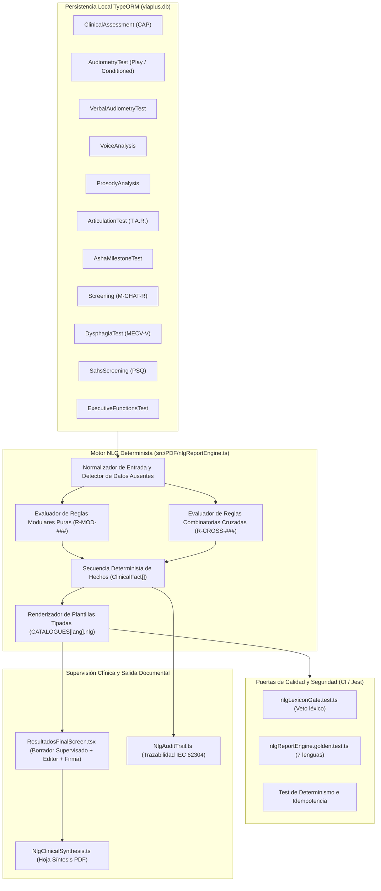

# Plan de Integración: Motor NLG Determinista en VIA+ (SaMD Clase IIa)

> **Estado:** Plan técnico ejecutable (Fase F1 de [`docs/PLAN-DE-TRABAJO.md`](./PLAN-DE-TRABAJO.md)).
> **Rama activa:** `NLG`
> **Marco regulatorio:** Reglamento (UE) 2017/745 (MDR, Clase IIa · Regla 11) · IEC 62304:2006+AMD1:2015 (Clase B) · ISO 14971:2019 · IEC 62366-1:2015 · ADR Cero IA en Dispositivo ([`docs/design/adr-inferencia-en-dispositivo.md`](./design/adr-inferencia-en-dispositivo.md)).

---

## 1. Goal Description y Justificación Clínica

Implementar e integrar en **VIA+** el **Motor de Generación de Lenguaje Natural (NLG) Determinista** (`src/PDF/nlgReportEngine.ts`), sustituyendo las funciones de interpretación aisladas y escritas con literales en castellano por un sistema centralizado de **síntesis clínica combinatoria trazable** sobre las entidades locales de TypeORM.

### 1.1 Diagnóstico del estado actual en el código (verificado en el árbol `src/`)

Actualmente existen **seis funciones de interpretación** repartidas por módulo y **cinco módulos adicionales** cuyos resultados se persisten sin síntesis narrativa unificada:

| # | Módulo | Fichero actual | Función / Estado actual | Deficiencia detectada |
|---|---|---|---|---|
| 1 | Audiometría Tonal y Condicionada | `src/Screens/Audiometry/audiometryResult.ts` | `interpretAudiometry(thresholds)` | Literales en castellano; no cruza con otoscopia del CAP; usa «no descarta» |
| 2 | Audiometría Verbal | `src/Screens/VerbalAudiometry/verbalAudiometryResult.ts` | `interpretVerbal(band, score, srtDb, lang)` | Literales en castellano; no cruza URV/SRT contra PTA tonal |
| 3 | Análisis Acústico de Voz | `src/Screens/VoiceAnalysis/voiceAnalysisResult.ts` | `buildInterpretation(p)` y `grbasSeverityLabel(g)` | Lenguaje normativo vetado («dentro de los rangos normativos», «Voz perceptualmente normal»); omite nota de compresión de shimmer frente a Praat |
| 4 | Análisis Prosódico | `src/Screens/ProsodyAnalysis/prosodyResult.ts` | `prosodyInterpretation(m, reason)` | Literales en castellano fuera de `src/I18n/` |
| 5 | Funciones Ejecutivas | `src/Screens/ExecutiveFunctions/executiveFunctionsGame.ts` | `interpretExecutiveFunctions(band, scores)` | Literales en castellano fuera de `src/I18n/` |
| 6 | Disfagia MECV-V | `src/Screens/DysphagiaTest/DysphagiaTestScreen.tsx` | Ternario en línea (líneas 492–497) | Acoplado a la vista `.tsx`, sin función pura testeable ni soporte multi-idioma |
| 7 | Evaluación Clínica Previa (CAP) | `src/Screens/ClinicalAssessment/clinicalAssessmentResult.ts` | `evaluateAssessment(...)` | Calcula `FULL`/`PARTIAL`/`BLOCKED`, pero no redacta invalidación ipsilateral hacia la audiometría en el informe |
| 8 | Cribado Autismo M-CHAT-R/F | `src/Screens/AutismScreening/autismScreeningResult.ts` | `levelFromScore` / `rangeLabelFromScore` | Solo etiqueta corta de rango; sin narrativa estructurada ni cruce con ASHA |
| 9 | Cribado SAHS Infantil | `src/Screens/SahsScreening/sahsScreeningResult.ts` | `computeSahsResult(...)` | Textos en castellano literal; no cruza con atención/funciones ejecutivas |
| 10 | Articulación · T.A.R. | `src/Screens/Articulation/articulationResult.ts` | `computeArticulationScore(...)` | Calcula `%` y `affectedPhonemes`, pero no genera párrafo descriptivo SODA por punto de articulación |
| 11 | Cribado de Hitos ASHA | `src/Screens/AshaScreening/ashaCdssEngine.ts` | `evaluateAshaScreening(...)` | Motor CDSS en castellano; falta integración en la síntesis global combinatoria |

### 1.2 Qué resuelve este plan

1. **Cero IA y cero generación estocástica en dispositivo:** Toda frase proviene de una función pura `(datos) => ClinicalFact[]` evaluada contra umbrales explícitos. Mismos datos de entrada producen exactamente el mismo texto y la misma traza byte a byte.
2. **Razonamiento clínico cruzado inter-módulo:** Evalúa la sesión como un acto clínico integral (otoscopia CAP frente a audiometría tonal, concordancia fono-audiométrica PTA frente a URV, estabilidad glótica frente a seguridad deglutoria MECV-V, y convergencia de alertas de neurodesarrollo ASHA + M-CHAT-R).
3. **Internacionalización tipada en las 7 variedades (`src/I18n/`):** Todas las plantillas viven bajo la clave `nlg` en `strings.es.ts`, `strings.gl.ts`, `strings.eu.ts`, `strings.ca.ts`, `strings.es-419.ts`, `strings.es-DO.ts` y `strings.en.ts`. Cualquier hueco en una lengua rompe `npx tsc --noEmit`.
4. **Saneamiento léxico y cumplimiento SaMD Clase IIa:** Sustitución de expresiones normativas o diagnósticas por lenguaje descriptivo de apoyo a la decisión clínica, blindado con un gate automatizado en Jest (`nlgLexiconGate.test.ts`).
5. **Trazabilidad regulatoria IEC 62304 Clase B:** Cada hecho clínico incorpora su `ruleId`, los valores medidos que lo dispararon y su referencia en la matriz de evidencia (`docs/design/matriz-evidencia-nlg.md`).
6. **Borrador supervisado y firma facultativa:** Presentación interactiva en `ResultadosFinalScreen.tsx` para que el clínico revise, edite o añada observaciones antes de firmar y compilar el PDF con `pdf-lib` (`src/PDF/templates/Report.ts`).

---

## 2. User Review Required

> [!IMPORTANT]
> **1. Muro Regulatorio SaMD Clase IIa (Regla 11 MDR) — Prohibición de Lenguaje Nosológico**
> El motor NLG **describe hallazgos objetivos y señala desvíos respecto a umbrales de referencia**, pero jamás emite diagnósticos causales ni clasifica al paciente como «sano», «normal» o «patológico». El gate `nlgLexiconGate.test.ts` fallará el build si alguna plantilla en cualquiera de las 7 lenguas introduce términos vetados sin exención justificada.

<!-- Separador -->

> [!IMPORTANT]
> **2. Regla de Datos Ausentes (Regla 4 de `CLAUDE.md`: nada falla en silencio)**
> Cuando una prueba esté incompleta, cerrada manualmente sin captura acústica o con umbrales no registrados, el motor emitirá un hecho explícito de «dato no disponible / exploración incompleta» (`level: 'warning'`). Bajo ninguna circunstancia un campo `null` o `undefined` caerá en la rama favorable.

<!-- Separador -->

> [!WARNING]
> **3. Retrocompatibilidad con las 79 Suites / 1023 Tests Actuales**
> Las funciones públicas existentes (`interpretAudiometry`, `interpretVerbal`, `buildInterpretation`, `prosodyInterpretation`, `interpretExecutiveFunctions`) mantendrán su firma exportada delegando internamente en el motor NLG con el idioma activo (`tNow()`), actualizando únicamente los asertos donde se corregía el lenguaje normativo de voz.

---

## 3. Open Questions y Decisiones Adoptadas

> [!NOTE]
> **D1. Ubicación del Anexo de Trazabilidad (`ruleId[]`) en el PDF**
> Se incluirá un bloque estructurado al pie de la página de **Síntesis Clínica Global** (`NlgClinicalSynthesis.ts`) y, cuando el número de reglas disparadas supere el espacio disponible, continuará en el bloque de auditoría (`NlgAuditTrail.ts`), listando `[ruleId] · Módulo · Valores medidos · Fuente de evidencia`.

<!-- Separador -->

> [!NOTE]
> **D2. Persistencia de las Observaciones Supervisadas del Clínico**
> El borrador generado por el motor NLG se calcula de forma determinista en tiempo real a partir de las entidades de la sesión, mientras que las matizaciones u observaciones añadidas por el profesional en la pantalla de pre-informe se pasan directamente a `generateReport({ evaluation, customSynthesisNotes, clinicianSignatureSvg })` y se archivan junto al cierre de la evaluación.

---

## 4. Arquitectura Técnica y Flujo de Datos



---

## 5. Catálogo Completo de Reglas Clínicas y Combinatorias

### 5.1 Reglas Cruzadas Inter-Módulo (`R-CROSS-*`)

| `ruleId` | Módulos implicados | Condición lógica de disparo | Efecto clínico en la síntesis | Fuente / Norma |
|---|---|---|---|---|
| `R-CROSS-001` | CAP × Audiometría Tonal | `cap.earRight` (o `earLeft`) $\in$ `['OMA', 'Cerumen', 'Perforación']` y existe umbral tonal medido en ese oído | Invalida técnicamente el PTA del oído afectado por hallazgo obstructivo/inflamatorio en otoscopia previa; recomienda reevaluación tras resolución médica | Protocolo CAP VIA+ / ISO 14971 |
| `R-CROSS-002` | CAP × Audiometría Tonal | `cap.earRight` (o `earLeft`) `=== 'OME'` y `PTA > 20 dB HL` en el oído homolateral | Señala concordancia entre elevación de umbral tonal y hallazgo otoscópico de otitis media con efusión (OME); sugiere valoración ORL e impedanciometría | BIAP Rec. 02/1 bis · Guía SEORL |
| `R-CROSS-003` | Audiometría Tonal × Verbal | Mejor PTA tonal `<= 20 dB HL` y (`discriminationPct < 80%` a 60 dB o `|srtDb - mejorPTA| > 15 dB`) | Señala disociación fono-audiométrica (umbrales tonales conservados con reconocimiento verbal reducido); sugiere explorar procesamiento auditivo o comprensión léxica | ASHA Central Auditory Processing |
| `R-CROSS-004` | Audiometría Tonal × T.A.R. | Umbral en `2000 Hz` o `4000 Hz > 25 dB HL` y `affectedPhonemes` incluye fricativas/sibilantes (`/s/`, `/f/`, `/z/`) | Señala correlación acústico-articulatoria: el descenso de sensibilidad en frecuencias agudas puede comprometer la percepción y producción de consonantes fricativas | Fonética acústica clínica / BIAP |
| `R-CROSS-005` | Voz Acústica × Disfagia | (`jitter > 1.04%` o `shimmer > 3.81%` o `hnr < 12 dB`) y `dysphagia.safetyAltered === true` | Alerta de precaución laringo-faríngea: coexistencia de perturbación acústica glótica y signos de compromiso de seguridad deglutoria en MECV-V | Clavé et al. (MECV-V) / ORL Pediátrica |
| `R-CROSS-006` | ASHA × Autismo M-CHAT-R | (`asha.riskLevel === 'red'` o fallo en dominio `pragmatic`/`receptive`) y `mchat.score >= 3` | Activa recomendación de derivación prioritaria conjunta a Neuropediatría y Atención Temprana por convergencia de alertas comunicativas y conductuales | ASHA P75 · Robins et al. (M-CHAT-R/F) |
| `R-CROSS-007` | SAHS × Funciones Ejecutivas | `sahs.suspicionLevel` $\in$ `['med', 'high']` y `ef.overallScore < 70` (o dominio `attention`/`inhibition < 65`) | Señala coexistencia de sospecha de trastorno respiratorio del sueño y rendimiento reducido en atención/inhibición diurna; sugiere correlacionar en consulta | Chervin et al. (PSQ SRBD-22) |

### 5.2 Reglas Modulares (`R-MOD-*`)

- **Certificado de Aptitud (CAP):**
  - `R-CAP-001`: Veredicto global `FULL` (condiciones visuales, motoras, verbales y otoscópicas verificadas).
  - `R-CAP-002`: Veredicto `PARTIAL` con desglose de dominios con restricción (`warn` o `block` unilateral).
  - `R-CAP-003`: Veredicto `BLOCKED` (no apto para batería estándar; requiere metodologías adaptadas).
- **Audiometría Tonal (`AudiometryTest`):**
  - `R-AUD-001`: Datos insuficientes en oído derecho, izquierdo o campo libre.
  - `R-AUD-002`: Descripción de PTA por oído (`OD`, `OI`) o binaural (`CL`) con clasificación descriptiva de banda en dB HL (`<= 20`, `21–40`, `41–70`, `71–90`, `> 90`) y morfología de curva (`plana`, `descendente en agudos`, `ascendente`).
  - `R-AUD-003`: Ausencia de respuesta al nivel máximo de salida en frecuencias específicas (`missingFreqs`).
  - `R-AUD-004`: Recomendación de derivación a ORL/Audiología cuando cualquier umbral supera `20 dB HL` o queda sin respuesta.
  - `R-AUD-005`: Nota metrológica de campo libre (estima el mejor oído y no discrimina asimetrías interaurales).
- **Audiometría Verbal (`VerbalAudiometryTest`):**
  - `R-VER-001`: Prueba sin estímulos presentados (`presentedCount === 0`).
  - `R-VER-002`: Porcentaje de reconocimiento verbal por nivel en dB, URV/SRT estimado y banda de edad (`A`–`D`).
  - `R-VER-003`: Constancia de variante lingüística (`es`, `gl`, `eu`, `es-DO`, `es-419`) o aviso explícito de banco prestado (`ca`, `en`).
  - `R-VER-004`: Recomendación de logoaudiometría diagnóstica cuando la discriminación a nivel conversacional es `< 80 %`.
- **Análisis Acústico de Voz (`VoiceAnalysis`):**
  - `R-VOZ-001`: Cierre manual sin captura acústica; reporta escala perceptual GRBAS si fue registrada.
  - `R-VOZ-002`: Reporte objetivo de parámetros medidos (`F0` en Hz, `jitter` local ciclo a ciclo en %, `shimmer` local ciclo a ciclo en %, `HNR` en dB y formantes `F1–F3`).
  - `R-VOZ-003`: Señalamiento descriptivo de parámetros situados fuera del intervalo de referencia pediátrico (`F0` fuera de `220–320 Hz`, `jitter > 1.04 %`, `shimmer > 3.81 %`, `HNR < 12 dB`).
  - `R-VOZ-004`: Nota técnica obligatoria sobre la estimación ciclo a ciclo de shimmer (compresión física de `1.3x–1.7x` frente a Praat documentada en `tools/acoustics/README.md`) e imposibilidad de estimar formantes si `formants === null`.
- **Análisis Prosódico (`ProsodyAnalysis`):**
  - `R-PRO-001`: Toma inválida o insuficiente (`reason !== 'ok'`: silencio, duración corta o ausencia de tramos periódicos).
  - `R-PRO-002`: Registro descriptivo de habla conectada (duración en segundos, núcleos silábicos, pausas, rango tonal en semitonos y velocidad de habla/articulación) con nota explícita de ausencia de baremo poblacional normativo.
- **Articulación T.A.R. (`ArticulationTest`):**
  - `R-ART-001`: Exploración sin ítems evaluados (`evaluatedCount === 0`).
  - `R-ART-002`: Resumen cuantitativo SODA (`evaluatedCount/totalCount`, `%` de producción concordante, desglose `S/O/D/A`).
  - `R-ART-003`: Relación de fonemas con error sistemático (`affectedPhonemes`) agrupados por punto de articulación y recomendación de valoración logopédica miofuncional/fonética.
- **Cribado de Hitos ASHA (`AshaMilestoneTest`):**
  - `R-ASH-001`: Banda evaluada con cumplimiento completo de los hitos contestados (`riskLevel === 'green'`).
  - `R-ASH-002`: Hitos no cumplidos sin bandera roja (`riskLevel === 'yellow'`), detallando dominios implicados (`receptive`, `expressive`, `pragmatic`).
  - `R-ASH-003`: Presencia de banderas rojas no cumplidas (`riskLevel === 'red'`), activando rutas de derivación interdisciplinar.
- **Cribado de Autismo M-CHAT-R (`Screening`):**
  - `R-AUT-001`: Cuestionario incompleto.
  - `R-AUT-002`: Puntuación total (`0–20`), banda de riesgo (`low`, `med`, `high`) y recomendación de entrevista de seguimiento (puntuación `3–7`) o derivación directa a atención temprana/neuropediatría (puntuación `>= 8`).
- **Exploración de Disfagia MECV-V (`DysphagiaTest`):**
  - `R-DYS-001`: Exploración sin signos de compromiso en eficacia ni seguridad en los bolos evaluados.
  - `R-DYS-002`: Compromiso de eficacia deglutoria (sello labial, residuo oral o deglución fraccionada) sin signos de compromiso respiratorio.
  - `R-DYS-003`: Compromiso de seguridad deglutoria (tos, cambio vocal o caída de `SpO2 >= 3 %` respecto a basal `basalSpO2`), detallando `minSpO2`, `maxDrop` y viscosidad/volumen recomendados.
- **Cribado SAHS Infantil (`SahsScreening`):**
  - `R-SAH-001`: Resumen de puntuación PSQ de Chervin (`psqYesCount/psqTotal`), grado amigdalar de Brodsky, categoría de IMC y nivel de sospecha orientativa (`low`, `med`, `high`), recordando que el diagnóstico definitivo exige polisomnografía en Unidad de Sueño.
- **Funciones Ejecutivas (`ExecutiveFunctionsTest`):**
  - `R-EF-001`: Exploración sin mini-juegos completados (`overallScore === null`).
  - `R-EF-002`: Índice global (`overallScore/100`) en la banda de edad (`A`–`D`), puntuaciones por dominio completado y dominios situados por debajo del umbral orientativo (`< 65/100`).

---

## 6. Saneamiento Léxico Regulatorio (Tabla de Sustitución)

| Fichero original | Frase actual (problemática) | Nueva formulación descriptiva (SaMD Clase IIa) |
|---|---|---|
| `voiceAnalysisResult.ts` | «Parámetros acústicos dentro de los rangos normativos para voz infantil. Calidad vocal sin signos de perturbación significativa.» | «Parámetros acústicos registrados dentro de los intervalos de referencia orientativos para voz pediátrica en esta toma (F0, jitter, shimmer y HNR sin desvíos por encima del umbral de alerta).» |
| `voiceAnalysisResult.ts` | «Voz perceptualmente normal» | «Escala perceptual GRBAS: grado global G0 (sin alteración perceptual registrada por el evaluador)» |
| `audiometryResult.ts` | «…y no descarta una pérdida unilateral.» | «…estima la respuesta del mejor oído y no permite evaluar cada oído por separado.» |
| `audiometryResult.ts` | Etiqueta «Normal» en severidad tonal | «Umbral dentro del rango de referencia (≤ 20 dB HL)» |
| `executiveFunctionsGame.ts` | «Rendimiento dentro de lo esperado en todos los dominios explorados.» | «Puntuaciones iguales o superiores al umbral orientativo (≥ 65/100) en los dominios completados.» |

---

## 7. Proposed Changes por Componente

### Componente 1: Núcleo del Motor NLG y Expediente de Evidencia

#### [NEW] `src/PDF/nlgReportEngine.ts`
Módulo puro en TypeScript (sin importar React ni componentes nativos) que exporta:
- Tipos `RuleCategory`, `FindingLevel`, `ClinicalFact`, `SessionEntities`, `NlgReportSynthesis`.
- Funciones evaluadoras por módulo: `evaluateCapFacts`, `evaluateAudiometryFacts`, `evaluateVerbalFacts`, `evaluateVoiceFacts`, `evaluateProsodyFacts`, `evaluateArticulationFacts`, `evaluateAshaFacts`, `evaluateAutismFacts`, `evaluateDysphagiaFacts`, `evaluateSahsFacts`, `evaluateEfFacts`.
- Función evaluadora combinatoria: `evaluateCrossModuleFacts(entities)`.
- Función principal: `evaluateSessionNlg(entities: SessionEntities, lang?: UiLang): NlgReportSynthesis`.
- Funciones puente para cada módulo individual (usadas por las pantallas y tarjetas de resultados).

#### [NEW] `docs/design/matriz-evidencia-nlg.md`
Documento técnico auditable que registra para cada `ruleId`:
- Identificador único y versión (`1.0.0`).
- Condición matemática exacta e inputs de la entidad TypeORM.
- Fuente bibliográfica y clínica (BIAP 02/1 bis, OMS, ASHA P75, Chervin 2000, Clavé 2008, Robins 2014, Klatt 1980 / Praat).
- Mitigación de riesgo asociada (ISO 14971).

---

### Componente 2: Catálogos i18n en las 7 Variedades (`src/I18n/`)

#### [MODIFY] `src/I18n/strings.es.ts`
Añadir la sección `nlg` al objeto `ES` (que define el tipo maestro `UiStrings`), con sub-bloques tipados para `sections`, `ui`, `rules` y `audit`.

#### [MODIFY] `src/I18n/strings.gl.ts` · `strings.eu.ts` · `strings.ca.ts` · `strings.es-419.ts` · `strings.es-DO.ts` · `strings.en.ts`
Implementar la totalidad de las propiedades y funciones de plantilla de `nlg` en las 6 variedades restantes, manteniendo el cumplimiento estricto de `Record<UiLang, UiStrings>`.

---

### Componente 3: Refactorización de Intérpretes Modulares y Tarjetas de Sesión

#### [MODIFY] `src/Screens/Audiometry/audiometryResult.ts`
Delegar `interpretAudiometry` en `renderAudiometryInterpretation(thresholds, getUiLang())` del motor NLG y ajustar etiquetas para eliminar términos vetados.

#### [MODIFY] `src/Screens/VerbalAudiometry/verbalAudiometryResult.ts`
Delegar `interpretVerbal` en `renderVerbalInterpretation(band, score, srtDb, lang, getUiLang())`.

#### [MODIFY] `src/Screens/VoiceAnalysis/voiceAnalysisResult.ts`
Delegar `buildInterpretation` y `grbasSeverityLabel` en el motor NLG, eliminando las frases normativas y añadiendo la nota técnica de shimmer frente a Praat.

#### [MODIFY] `src/Screens/ProsodyAnalysis/prosodyResult.ts`
Delegar `prosodyInterpretation` y `prosodyReasonLabel` en las plantillas localizadas del motor NLG.

#### [MODIFY] `src/Screens/ExecutiveFunctions/executiveFunctionsGame.ts`
Delegar `interpretExecutiveFunctions` en el motor NLG localizado.

#### [MODIFY] `src/Screens/DysphagiaTest/DysphagiaTestScreen.tsx`
Sustituir el ternario en línea de `interpretation` por `renderDysphagiaInterpretation(...)` exportado desde el motor NLG.

#### [MODIFY] `src/Screens/ResultadosPreliminares/evaluationResults.ts`
Usar las funciones localizadas del motor NLG al construir las tarjetas `ResultCard` de cada módulo.

---

### Componente 4: UI de Borrador Supervisado y Exportación PDF

#### [MODIFY] `src/Screens/ResultadosFinal/ResultadosFinalScreen.tsx`
- Cargar todas las entidades de la evaluación activa (`ClinicalAssessment`, `AudiometryTest`, `VerbalAudiometryTest`, `VoiceAnalysis`, `ProsodyAnalysis`, `ArticulationTest`, `AshaMilestoneTest`, `Screening`, `DysphagiaTest`, `SahsScreening`, `ExecutiveFunctionsTest`).
- Ejecutar `evaluateSessionNlg(sessionEntities, lang)` mediante `useMemo`.
- Añadir el panel de **Síntesis Clínica Global (Motor NLG Determinista)**:
  - Visualización de hallazgos cruzados (`crossModuleFindings`), síntesis por dominio y derivaciones sugeridas.
  - Chip de trazabilidad con los `ruleId` activados (`R-CROSS-001`, `R-AUD-002`, etc.).
  - Campo editable (`TextInput` multilínea) para que el clínico supervise, matice o añada observaciones clínicas antes del sellado.
- Conectar el borrador supervisado con `generateReport({ evaluation, nlgSynthesis, clinicianNotes })`.

#### [NEW] `src/PDF/blocks/NlgClinicalSynthesis.ts`
Bloque de `pdf-lib` que dibuja la página de **Síntesis Clínica Global** tras la portada del informe PDF, incluyendo:
- Resumen ejecutivo y hallazgos cruzados inter-módulo.
- Síntesis estructurada por dominios.
- Observaciones supervisadas por el facultativo y firma/sello profesional.
- Aviso regulatorio SaMD Clase IIa.

#### [NEW] `src/PDF/blocks/NlgAuditTrail.ts`
Bloque de `pdf-lib` que dibuja la tabla de **Trazabilidad de Reglas Clínicas (IEC 62304 Clase B)** con `ruleId`, categoría, valores disparadores y fuente de evidencia.

#### [MODIFY] `src/PDF/blocks/index.ts` y `src/PDF/templates/Report.ts`
Registrar los dos bloques nuevos e invocar `evaluateSessionNlg` dentro de `generateReport` para insertar la Síntesis Clínica Global y el Anexo de Trazabilidad en el PDF final.

---

### Componente 5: Suite de Tests y Puertas de Calidad

#### [NEW] `src/PDF/__tests__/nlgReportEngine.test.ts`
- Cobertura unitaria de cada `ruleId` modular y cruzado (al menos un caso que dispara la regla y un caso que no la dispara).
- Verificación de datos ausentes (`null` / incompletos) comprobando que nunca caen en la rama favorable.

#### [NEW] `src/PDF/__tests__/nlgReportEngine.golden.test.ts`
- Casos clínicos completos (*golden tests*) evaluados en las 7 lenguas (`es`, `gl`, `eu`, `ca`, `es-419`, `es-DO`, `en`).
- Prueba de determinismo e idempotencia: 50 ejecuciones consecutivas con las mismas entidades devuelven idéntico `formattedReportText` y `ruleIds` byte a byte.

#### [NEW] `src/PDF/__tests__/nlgLexiconGate.test.ts`
- Gate automatizado que recorre las plantillas `CATALOGUES[lang].nlg` en las 7 lenguas y salidas de casos arquetípicos, prohibiendo términos diagnósticos o normativos absolutos (`/\bdiagnóstico confirmado\b/i`, `/\bpatológico\b/i`, `/\bvoz perceptualmente normal\b/i`, `/\bdentro de los rangos normativos\b/i`, `/\bsano\b/i`, `/\benfermo\b/i`).

---

## 8. Verification Plan

### 8.1 Puertas Automatizadas Obligatorias (Local y CI)

```bash
npx tsc --noEmit
npx jest
npx eslint . --ext .js,.jsx,.ts,.tsx
node scripts/check-verbal-coverage.js --strict
node scripts/check-lua-sprite.js
node scripts/build-launcher-icons.js --check
node scripts/resize-verbal-images.js --check
node scripts/build-lua-protocol.js --check
node scripts/check-ui-strings.js
npm run lint:md
```

### 8.2 Criterios Binarios de Aceptación
- `npx tsc --noEmit`: salida `0` (confirma que los 7 catálogos implementan el contrato completo de `nlg`).
- `npx jest`: 100 % de suites en verde, incluyendo `nlgReportEngine.test.ts`, `nlgReportEngine.golden.test.ts` y `nlgLexiconGate.test.ts`.
- `npx eslint . --ext .js,.jsx,.ts,.tsx`: `0 errors, 0 warnings`.
- `node scripts/check-ui-strings.js`: `0` literales quemados en `.tsx`.
- `npm run lint:md`: `0` errores de formato Markdown en toda la documentación del repositorio.
